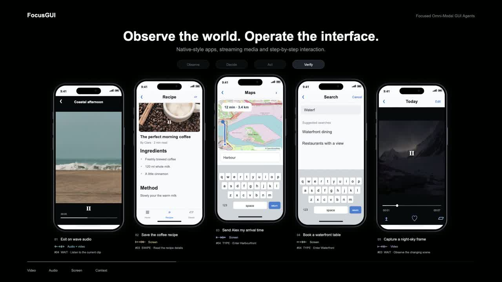

<div align="center">

## Focused Omni-Modal GUI Agents

**Fuyao Zhang · Wenwen He · Jiaming Zhang · Yurong Hao · Xuan Wang**<br>
**Guowei Guan · Che Wang · Longtao Huang · Wei Yang Bryan Lim**

Nanyang Technological University · Alibaba Group

[](https://arxiv.org/abs/2610.26203)
[](https://arxiv.org/pdf/2610.26203)
[](https://fyzhang1.github.io/FocusGUI/)

**Step-adaptive evidence selection. Compact focus. Original decoder.**

[Demo](#demo) · [Overview](#overview) · [Quick Start](#quick-start) · [Backbones](#other-backbones) · [Code Map](#code-map) · [Citation](#citation)

</div>

## Demo

[](https://fyzhang1.github.io/#publications)

[Watch on the homepage](https://fyzhang1.github.io/#publications) · [Download MP4](assets/focusgui_demo.mp4)

A 36-second illustrative demo of five parallel multimodal GUI workflows, with video, audio, typing, scrolling, and result verification. The interfaces and action sequences are simulated; this is not a recording of model inference. Stock media and sound credits are listed in [Demo media credits](assets/DEMO_MEDIA_CREDITS.md).

## Overview

FocusGUI is a lightweight adapter for omni-modal GUI agents. It organizes
the evidence available at each interaction step and conditions the next
action without replacing the pretrained decoder or its language-model head.

<p align="center">
  
</p>

*Method overview from Figure 2 of [Focused Omni-Modal GUI Agents](https://arxiv.org/abs/2610.26203).*

| Stage | Role |
|---|---|
| Channel decomposition | Expose complementary evidence from the current observation. |
| Step-adaptive prioritization | Weight channels against the current full-modal decision reference. |
| Compact focus | Project the weighted evidence into a low-dimensional latent. |
| Residual alignment | Add a zero-initialized residual at the action-generation boundary. |

Only the adapter is trained. The backbone, Transformer decoder, and original
LM head stay frozen, and actions are generated autoregressively as structured
JSON. Training uses action annotations rather than modality-relevance labels.

## Quick Start

### 1. Install

```bash
git clone https://github.com/fyzhang1/FocusGUI.git
cd FocusGUI
conda create -n focusgui python=3.10 -y
conda activate focusgui
pip install -e ".[qwen]"
```

Use a CUDA-enabled PyTorch build matching your system. Other backbones may
require separate environments and their upstream runtime dependencies.
Configuration variables are listed in [.env.example](.env.example); export
them in your shell when overriding model locations.

### 2. Prepare the data

Follow [DATA.md](DATA.md) to download OmniGUI separately, then run:

```bash
python scripts/prepare_omnigui_chunks.py
```

The training scripts split by episode using seed `20260626`, with
70%/10%/20% train/dev/test proportions. Validation selects the checkpoint;
held-out test observations are used for final action generation.

### 3. Extract frozen Qwen evidence

The following commands can run in separate terminals on two GPUs:

```bash
CUDA_VISIBLE_DEVICES=0 python scripts/extract_qwen_focusgui_evidence.py \
  --shard-index 0 --num-shards 2 \
  --out logs/focusgui_evidence/qwen_shard0.npz

CUDA_VISIBLE_DEVICES=1 python scripts/extract_qwen_focusgui_evidence.py \
  --shard-index 1 --num-shards 2 \
  --out logs/focusgui_evidence/qwen_shard1.npz
```

### 4. Train and evaluate

```bash
torchrun --standalone --nproc_per_node=2 \
  scripts/train_focusgui_lm_adapter_qwen.py \
  --semantic-evidence-cache \
    logs/focusgui_evidence/qwen_shard0.npz,logs/focusgui_evidence/qwen_shard1.npz \
  --fusion-mode dynamic \
  --no-vib --beta-kl 0 --lambda-weight 0 \
  --generation-split test \
  --out-dir logs/focusgui_qwen
```

This trains the deterministic adapter and generates held-out actions with
Qwen's original decoder and LM head. For one GPU, use
`CUDA_VISIBLE_DEVICES=0 python scripts/train_focusgui_lm_adapter_qwen.py`
with the same arguments in place of `torchrun`.

Checkpoints and prediction records are written to `logs/focusgui_qwen/`.
Use `--help` for evaluation-only execution and the available controls.

## Other Backbones

| Backbone | Local weights environment variable | Adapter launcher |
|---|---|---|
| Qwen2.5-Omni-7B | `QWEN2_5_OMNI_PRETRAINED` | `train_focusgui_lm_adapter_qwen.py` |
| MiniCPM-o-4.5 | `MINICPM_O_PRETRAINED` | `train_focusgui_lm_adapter_minicpm.sh` |
| VITA-1.5 | `VITA_PRETRAINED` | `train_focusgui_lm_adapter_vita.sh` |
| Baichuan-Omni-1.5 | `BAICHUAN_OMNI_PRETRAINED` | `train_focusgui_lm_adapter_baichuan.sh` |

First extract the shared label-free observation descriptors:

```bash
python scripts/extract_observation_descriptors.py
```

Then extract the selected backbone's frozen hidden evidence and launch FocusGUI:

```bash
python scripts/extract_minicpm_hidden_states.py
bash scripts/train_focusgui_lm_adapter_minicpm.sh

python scripts/extract_vita_hidden_states.py
bash scripts/train_focusgui_lm_adapter_vita.sh

python scripts/extract_baichuan_hidden_states.py
bash scripts/train_focusgui_lm_adapter_baichuan.sh
```

After all three hidden caches are available, run their adapter training and
evaluation sequentially with:

```bash
bash scripts/run_focusgui_other_models.sh
```

Launchers use the active Python environment; set `PYTHON` to another
interpreter if needed. VITA requires its source tree through `VITA_CODE_PATH`.
Use `BAICHUAN_COMPAT_PATH` when your Baichuan installation requires an
additional compatibility package.

## Code Map

| Entry point | Purpose |
|---|---|
| [`focusgui_common.py`](scripts/focusgui_common.py) | Episode splits and projection utilities |
| [`extract_qwen_focusgui_evidence.py`](scripts/extract_qwen_focusgui_evidence.py) | Native Qwen modality evidence |
| [`extract_observation_descriptors.py`](scripts/extract_observation_descriptors.py) | Label-free observation descriptors |
| [`train_focusgui_lm_adapter_qwen.py`](scripts/train_focusgui_lm_adapter_qwen.py) | Qwen adapter training and generation |
| [`train_focusgui_lm_adapter_multibackbone.py`](scripts/train_focusgui_lm_adapter_multibackbone.py) | MiniCPM, VITA, and Baichuan adapters |
| [`run_qwen_focusgui_fusion_ablation.sh`](scripts/run_qwen_focusgui_fusion_ablation.sh) | Fusion controls under a shared protocol |
| [`analyze_focusgui_trajectory_depth.py`](scripts/analyze_focusgui_trajectory_depth.py) | Performance across interaction depth |
| [`plot_focusgui_channel_prioritization.py`](scripts/plot_focusgui_channel_prioritization.py) | Channel-priority statistics |
| [`lmms_eval/`](lmms_eval/) | Required model wrappers, prompts, and evaluation infrastructure |

The repository publishes maintained code and the paper overview figure.
Datasets, media, model weights, checkpoints, prediction logs, hidden caches,
and third-party grounding baseline implementations are not bundled.

## Citation

```bibtex
@article{zhang2026focusgui,
  title   = {Focused Omni-Modal GUI Agents},
  author  = {Fuyao Zhang and Wenwen He and Jiaming Zhang and Yurong Hao and
             Xuan Wang and Guowei Guan and Che Wang and Longtao Huang and
             Wei Yang Bryan Lim},
  journal = {arXiv preprint arXiv:2610.26203},
  year    = {2026},
  doi     = {10.48550/arXiv.2610.26203},
  url     = {https://arxiv.org/abs/2610.26203}
}
```
