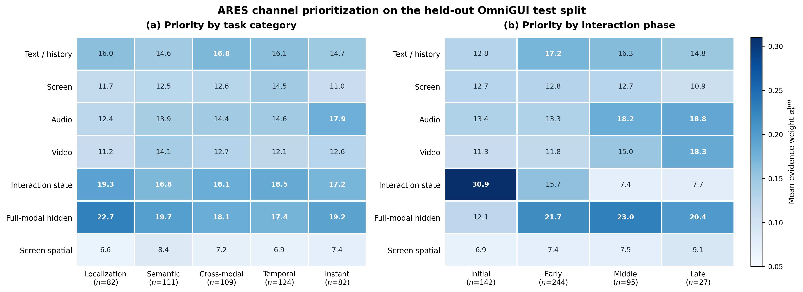

# Corrected FOG Channel Prioritization

This analysis uses the corrected generative FOG result, in which the original omni-modal decoder and LM head are frozen and no legacy classification head is used. All statistics come from the `508` held-out test actions (`142` episodes). Task labels and step indices are used only to aggregate post-inference weights; they are never inputs to the gate.

## Task-Category Priority (%)

| Channel | Localization (82) | Semantic (111) | Cross-modal (109) | Temporal (124) | Instant (82) |
|---|---:|---:|---:|---:|---:|
| Text / history | 16.03 | 14.59 | 16.85 | 16.07 | 14.69 |
| Screen | 11.75 | 12.48 | 12.56 | 14.52 | 10.99 |
| Audio | 12.35 | 13.85 | 14.37 | 14.56 | 17.89 |
| Video | 11.19 | 14.12 | 12.75 | 12.09 | 12.62 |
| Interaction state | 19.35 | 16.82 | 18.14 | 18.49 | 17.15 |
| Full-modal hidden | 22.69 | 19.72 | 18.13 | 17.39 | 19.23 |
| Screen spatial | 6.64 | 8.43 | 7.20 | 6.88 | 7.43 |

## Interaction-Phase Priority (%)

Phase definitions are: Initial = step 0; Early = steps 1--2; Middle = steps 3--4; Late = steps 5 and later.

| Channel | Initial (142) | Early (244) | Middle (95) | Late (27) |
|---|---:|---:|---:|---:|
| Text / history | 12.85 | 17.21 | 16.25 | 14.75 |
| Screen | 12.66 | 12.81 | 12.67 | 10.89 |
| Audio | 13.37 | 13.33 | 18.20 | 18.85 |
| Video | 11.29 | 11.83 | 14.98 | 18.35 |
| Interaction state | 30.85 | 15.72 | 7.43 | 7.71 |
| Full-modal hidden | 12.13 | 21.73 | 22.99 | 20.38 |
| Screen spatial | 6.85 | 7.37 | 7.49 | 9.07 |

## Variation Summary

| Channel | Category range (pp) | Phase range (pp) |
|---|---:|---:|
| Text / history | 2.26 | 4.37 |
| Screen | 3.54 | 1.92 |
| Audio | 5.54 | 5.51 |
| Video | 2.93 | 7.06 |
| Interaction state | 2.53 | 23.43 |
| Full-modal hidden | 5.30 | 10.85 |
| Screen spatial | 1.78 | 2.22 |

## Cluster-Aware Association Tests

Category labels are permuted across episodes; phase labels are permuted only among steps of the same episode. Reported $q$ values use Benjamini--Hochberg correction over the seven channels separately for each analysis.

| Channel | Category $p$ | Category $q$ | Phase $p$ | Phase $q$ |
|---|---:|---:|---:|---:|
| Text / history | 0.4743 | 0.5681 | 0.0002 | 0.0003 |
| Screen | 0.4869 | 0.5681 | 0.5747 | 0.5747 |
| Audio | 0.0446 | 0.3121 | 0.0002 | 0.0003 |
| Video | 0.7243 | 0.7243 | 0.0002 | 0.0003 |
| Interaction state | 0.2585 | 0.4525 | 0.0002 | 0.0003 |
| Full-modal hidden | 0.2106 | 0.4525 | 0.0002 | 0.0003 |
| Screen spatial | 0.2240 | 0.4525 | 0.0568 | 0.0663 |

The mean per-action total-variation distance from the global channel distribution is `0.2284` (median `0.2257`). This confirms that the dynamic gate does not apply one identical weight vector to every action.

## Honest Interpretation

- Localization places the largest mean weight on the integrated full-modal channel, followed by interaction state. This is consistent with relying on the current integrated GUI state, but it is not a pure screen-only routing pattern.
- Instant Response assigns the highest Audio weight among the five categories. This is the clearest task-category-aligned shift in the current result.
- Temporal Reasoning does **not** prioritize the standalone Video channel: its mean Video weight is below the overall Video mean. Cross-modal Discrimination likewise does **not** assign its highest weight to standalone Audio. These intuitively attractive patterns are not supported by the current checkpoint and must not be claimed.
- Interaction phase produces a stronger routing shift than task category. Initial actions strongly prioritize interaction state; later actions reduce state weight and place more mass on audio, video, and integrated full-modal evidence.
- Cluster-aware permutation tests confirm this phase dependence for Text/History, Audio, Video, Interaction State, and Full-modal Hidden after multiple-testing correction ($q<0.001$). In contrast, no task-category association remains significant after correcting across seven channels. Category differences in this figure are therefore descriptive tendencies, not confirmatory evidence.
- The integrated full-modal channel already contains mixed audio-visual information. Therefore, a low standalone Audio or Video weight can reflect redundancy with the integrated channel rather than rejection of that modality.

## Scientific Scope

The heatmap visualizes the gate's learned routing posterior, not a causal oracle of modality importance. The current evidence establishes adaptive channel prioritization across individual actions and interaction phases. It does not establish a statistically robust task-category effect, although several descriptive category tendencies are visible. Causal claims about whether a channel is necessary still require modality ablation or intervention.

Source SHA-256: `6b7f3d67d4bf39b7eb84ffdeb6d99cc3e8ff913a0984777274b9482ba73c64f4`
